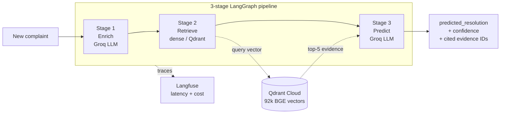

# Bank Complaint Resolution Intelligence

A production-grade RAG system that predicts the likely **resolution outcome** of a
bank complaint by retrieving similar past complaints from a 92k-record CFPB corpus
and reasoning over their known outcomes. Built eval-first: every retrieval decision
is backed by a number on a labeled test set, including the decisions that said "no."

> **The honest headline:** the most interesting result in this project is a
> *negative* one. Hybrid retrieval (BM25 + dense) and cross-encoder reranking —
> the techniques you're "supposed" to add — both **reduced** recall on this task.
> The system ships the simpler dense-only retriever because that's what the eval
> said was best. See [Eval Results](#eval-results).

---

## Problem

A bank teller handling a new complaint has no cheap way to know how similar cases
were resolved. This system gives them that context before they work the case:

> *"3 of 5 similar overdraft-fee complaints were resolved with monetary relief;
> strong precedent for fee reversal."*
> → `predicted_resolution: "Closed with monetary relief", confidence: 0.73`

Ground truth is free: CFPB publishes the actual `company_response` for every
complaint, so resolution-prediction accuracy is measurable on the entire corpus
with no manual labeling.

## Architecture



| Stage | What it does | Output |
|-------|-------------|--------|
| 1 · Enrich | LLM extracts product, issue summary, severity signals from raw text | `EnrichedComplaint` (Pydantic) |
| 2 · Retrieve | Dense vector search over 92k complaints, leave-one-out | top-5 `EvidenceComplaint` with known outcomes |
| 3 · Predict | LLM reasons over the evidence's outcome distribution | `ResolutionPrediction` + cited evidence IDs |

Stages communicate via typed Pydantic state, not string concatenation. The
retrieval strategy is **injected**, so swapping retrievers (or vector backends)
is a one-line config change — which is exactly what made the eval-driven
comparison below possible.

## Eval Results

Measured on 80 labeled queries. **Two eval sets exist, and the story of why is
the point:**

### The eval caught its own bias (v1 → v2)

v1's "similar complaint" labels were mined *only* from MiniLM dense neighbors, so
MiniLM won **by construction** and every other retriever was penalized for
surfacing different-but-valid complaints (BM25 scored a nonsensical 0.07). v2
fixes this with **TREC-style pooled relevance judgments**: candidates pooled from
MiniLM + BGE + BM25, same LLM judge. All comparisons below use v2. (ADR-010.)

### Retrieval (eval set v2, recall@k · leave-one-out)

| Retriever | Recall@5 | Recall@10 | MRR@10 | Verdict |
|-----------|:--------:|:---------:|:------:|---------|
| **Dense MiniLM** | **0.457** | 0.493 | 0.706 | shipped (ties BGE, smaller) |
| **Dense BGE-small** | **0.456** | 0.463 | 0.630 | deployed (already in Qdrant) |
| BM25-only | 0.272 | 0.254 | 0.442 | lexical floor |
| Hybrid RRF (dense+BM25) | 0.365 | 0.372 | 0.582 | ❌ worse than dense alone |
| Hybrid + cross-encoder rerank | 0.282 | 0.306 | 0.497 | ❌ worst |

**Why the fancy techniques lost** (full write-up in [docs/eval-results.md](docs/eval-results.md)):
- **BGE ≈ MiniLM** — a 384-dim upgrade is a wash on long, domain-specific narratives.
- **Hybrid hurt** — equal-weight RRF fused a strong leg (0.46) with a weak one
  (0.27) and landed between them; reweighting only converges back to dense-alone.
- **Reranking hurt most** — `bge-reranker-base` is trained for query→passage
  *relevance* (asymmetric), but this is narrative↔narrative *similarity*
  (symmetric). It's the wrong tool; the dense bi-encoder is trained for exactly
  this objective. Diagnosed on a 12-query probe (degrades even at 158 tokens, so
  it's not just truncation).

### Resolution prediction (Stage 3, held-out)

| Config | Accuracy | Macro-F1 | Majority baseline (Acc / F1) | N |
|--------|:--------:|:--------:|:----------------------------:|:-:|
| Dense retrieval + Groq gpt-oss-120b | _pending_ | _pending_ | _pending_ | 100 |

Held-out by construction: the complaint being predicted is excluded from its own
retrieval. Macro-F1 is reported because resolutions are heavily imbalanced
("Closed with explanation" dominates) — accuracy alone would reward guessing the
majority class.

## Observability

Every LLM call is traced in Langfuse with per-stage latency and token cost
(Groq pricing registered). Measured: ~2.7–3.2s end-to-end per query,
~$0.0003/query (enrich + predict).

## Quick Start

```bash
python -m venv .venv && source .venv/bin/activate
pip install -e ".[dev]"
cp .env.example .env            # fill in GROQ / LANGFUSE / QDRANT keys

# Data pipeline (downloads ~100k complaints, dedups to 92k, embeds + indexes)
python -m src.data.download_cfpb
python -m src.data.deduplicate_corpus
python -m src.data.ingest --reset        # embeds into local ChromaDB

# Evaluate a retriever against the labeled set
python -m src.evaluation.run_retrieval_evals --retriever dense \
    --eval-set data/eval/eval_set_v2.json

# Resolution-prediction eval (held-out, vs majority baseline)
python -m src.evaluation.predict_eval --retriever dense --n 100

# Serve (REST at /predict + /docs, Gradio demo at /ui)
uvicorn src.api.main:app --reload --port 8000
```

## Tech Stack

| Component | Choice | Why |
|-----------|--------|-----|
| Orchestration | LangGraph | Typed multi-stage state; per-stage tracing; injectable nodes |
| Embeddings | BGE-small-en-v1.5 (MiniLM baseline) | 384-dim, CPU-friendly; measured as a tie — kept BGE as deployed |
| Vector DB | ChromaDB (dev) → Qdrant Cloud (prod) | Local speed in dev; managed + metadata filtering in prod (ADR-002, migration ADR-011) |
| Reranker | *none* (tested, removed) | Cross-encoder reduced recall on this symmetric task — negative finding |
| LLM | Groq `openai/gpt-oss-120b` | Fast hosted inference; OpenAI-compatible API; the available Groq model |
| Observability | Langfuse | Per-stage latency + token cost |
| API / Demo | FastAPI + Gradio | Auto-docs + Pydantic validation; Gradio UI for the live demo |
| Deployment | Hugging Face Spaces | Free tier holds the embedding model in memory (ADR pending) |

## Data

[CFPB Consumer Complaint Database](https://www.consumerfinance.gov/data-research/consumer-complaints/):
99,730 complaints downloaded (5 product categories) → **92,045 after dedup**
(7.7% removed). The corpus contained coordinated template campaigns — the largest
was 1,859 near-identical Cash App copies — removed via TF-IDF cosine dedup within
(product, issue) groups so they don't dominate retrieval (ADR-007).

Raw data and the vector index are **not** in git (see `.gitignore`); the commands
above regenerate them.

## Documentation

- [docs/decisions.md](docs/decisions.md) — 11 ADRs, each with the alternatives and the number that justified the choice
- [docs/eval-results.md](docs/eval-results.md) — full experiment log, v1-vs-v2 bias story, reranker root-cause
- [docs/resume-bullets.md](docs/resume-bullets.md) — the measured outcomes

## License

MIT
